# 07 · 组件测试：mount 直挂真浏览器，跳过整个 SUT

> E2E 测一个按钮要点登录、导航、等接口；组件测试直接把按钮挂进真浏览器。
> 本实验用 `@playwright/experimental-ct-react` 测 pw-store 的三个订单组件
> （props、事件、条件渲染、children 插槽、重渲染），8 条用例 1.0 秒跑完，
> 并与 E2E 冒烟套件做了同机耗时对照。

## Background

E2E 是黑盒：驱动整个应用走用户路径。但组件级的缺陷（某个 prop 组合渲染错、
某个边界输入没防御）用 E2E 覆盖成本极高——为一个按钮写一条完整用户旅程不值当。

传统组件测试（Jest + Testing Library）在 jsdom（浏览器环境的 JS 模拟）里跑，
没有真实渲染管线：布局、样式、真实事件传播统统缺失。

Playwright 的组件测试（Component Testing，下称 ct）换了一条路：
**在真 Chromium 里挂载组件**，断言 API 与 E2E 完全相同
（locator + web-first 断言），但不需要被测应用（SUT，见 lab 02）运行。

## What

ct 的核心是 `mount`：把一个 React 组件挂进浏览器页面，返回可定位、可 update 的引用。

用例形态是"挂载 → 用 E2E 同款断言查真实 DOM → 用回调收集器验证事件"。

可以把 ct runner 想成摄影棚：E2E 是街拍（整个城市都在运转——SUT、网络、数据），
ct 是棚拍（只请这位演员进场，背景全白），同一台相机，布景成本差一个数量级。

但和摄影棚不同，ct 的组件不是布景——它是被构建产物
（vite 按生产规则编译 TSX）真实渲染出来的 DOM。



> 🌐 **交互版**：[在线打开（GitHub Pages）](https://yong-huang.github.io/hands-on-test-frameworks/playwright/07_pw_component/images/ct.html)
> （或本地打开 [`images/ct.html`](images/ct.html)）。
> 上下两条路径共用同一个 Chromium 内核，上图无网络、下图全程要网。

## When to Use

| 场景 | ct | E2E |
|:---|:---|:---|
| 单组件的 props / 事件 / 条件渲染 | ✅ 毫秒级反馈 | 成本高、定位难 |
| 设计系统全量组件回归 | ✅ 千条用例可承受 | 不可行 |
| 纯展示组件的视觉快照 | ✅ 与 lab 06 组合 | 页面级才合适 |
| 跨组件协作、路由、真实接口 | ❌ 没有这些层 | ✅ 主战场 |
| 挂载后立即网络请求的容器组件 | ⚠️ 需 mock 请求层 | ✅ 天然覆盖 |

判断口径：**金字塔 still 成立**——ct 铺底部吃掉组件级缺陷，E2E 守顶部关键路径。
被测组件要"props 进、事件出"，带全局状态或立即请求的组件先做依赖注入改造。

## Quick Start

```bash
cd playwright/07_pw_component
./component.sh          # apply 体检 → observe ct 套件 + 耗时对照 → clean
```

observe ① 跑 8 条组件用例，不起 SUT、不发请求：

```
  ✓  1 StatusBadge：三种状态渲染三样文案 (91ms)
  ✓  3 OrderCard：点删除按钮，onDelete 带着订单 id 回调 (78ms)
  ✓  8 props 变化触发重渲染：徽标随 status 更新 (47ms)
  8 passed (1.0s)
```

observe ② 用 `/usr/bin/time` 对 ct 套件与 lab 02 的 E2E 冒烟套件（同为 8 用例）计时：

```
>>> ct  套件（8 用例，无网络）: 1340 ms
>>> E2E 套件（8 用例，含 SUT+浏览器流程）: 5820 ms
```

验收方式：ct 套件全绿且快于 E2E 对照组；把 `OrderForm` 的空白标题防御
（`if (!trimmed) return`）临时注释掉重跑，"空白标题不触发回调"用例必须变红。

## How It Works

**ct 配置与 E2E 配置是两套体系。** `playwright-ct.config.ts` 从 ct 包导入
`defineConfig`，用例目录里还需要 `playwright/index.html`（挂载点模板）
与 `playwright/index.ts`（全局样式）。

runner 起一个内置 vite dev server（本工程定端口 9007），把 TSX 现场编译进真浏览器。
版本上 ct 包与 `@playwright/test` 必须同版本（本系列锁 1.62.1，见 lab 01 的 Q&A）。

**一测试一根（React root）。** 每条用例只有一次 React 挂载预算：第二次 `mount` 直接报
`already has a React root`（本实验实测踩过）。

要一次看多个组件，挂一个组合容器（本实验的 StatusBadge 三状态用例就是这么写的）；
要测重渲染，用返回引用的 `comp.update(<新 props />)`。

**事件验证靠回调收集器。** `onDelete={(id) => { deletedId = id; }}` 把组件吐出的事件
存进闭包变量，点击后断言变量——等价于前端测试里的 mock spy，只是手写三行。

条件渲染用 `toHaveCount(0)` 断言"不传回调就没有按钮"，和 E2E 同一套定位语法。

**耗时差异的来源要读准。** ct 1.3s vs E2E 5.8s，差距不只"少发请求"：
E2E 每用例要登录、导航、等接口，ct 只做 mount 与断言。

ct 的墙钟里还含 vite dev server 冷启动（约 0.4s），用例越多这项被摊得越薄——
组件回归跑几百条时 ct 的速度优势会进一步放大。

## Pitfalls & Q&A

**Q：为什么定位用 `page.getByTestId` 而不是 mount 返回的 `comp.getByTestId`？**
实测：`comp` 定位带组件边界（`internal:control=component`），
在嵌套子组件内部的元素上会找不到（OrderCard 里的 StatusBadge 徽标）。

`page.getByTestId` 语义不变且全部稳定。`comp` 保留两个不可替代的用途：
`comp.update()` 重渲染、以及需要严格限定在根组件范围内时的定位。

**Q：为什么不能在一个测试里 mount 多次？**
ct 的挂载点是一个单例 React root，二次 mount 会撞
"already has a React root"（本实验实测踩过）。多组件场景挂组合容器，
一次 mount 表达整个场景——这和真实页面"一棵组件树"的形态也一致。

**Q：组件里用了 `useState`，测试怎么没有触发 React 的 act 警告？**
act（断言环境里包住状态更新的机制）是 react-testing-library 生态的概念；
ct 走真实浏览器渲染 + web-first 断言轮询，断言天然等"最终状态"，
不需要同步性承诺，因此没有 act 问题。

**Q：ct 能测 lab 02 里那些发请求的页面组件吗？**
可以但要先解耦：把请求逻辑抽成可注入的 hook 或 props（如 `OrdersPage` 的
数据获取上移），页面组件只收数据与回调。

不改组件直接测也行——在 ct 里 `route` mock 掉请求（网络虚拟化在 ct 同样可用），
但那已经向集成测试漂移，属于团队自选风格。

**Q：ct 和 Vitest + Testing Library 怎么选？**
同一层能力，主要差异是渲染环境（真浏览器 vs jsdom）与断言 API。

选 ct 的理由：断言语法与本系列 E2E 完全一致（一套技能两处用）、
样式与布局类缺陷能被真实渲染暴露。选后者的理由：生态更成熟、跑得更快、
与 Vite 单测体系天然集成。本系列选 ct 是为了技能栈收敛。
